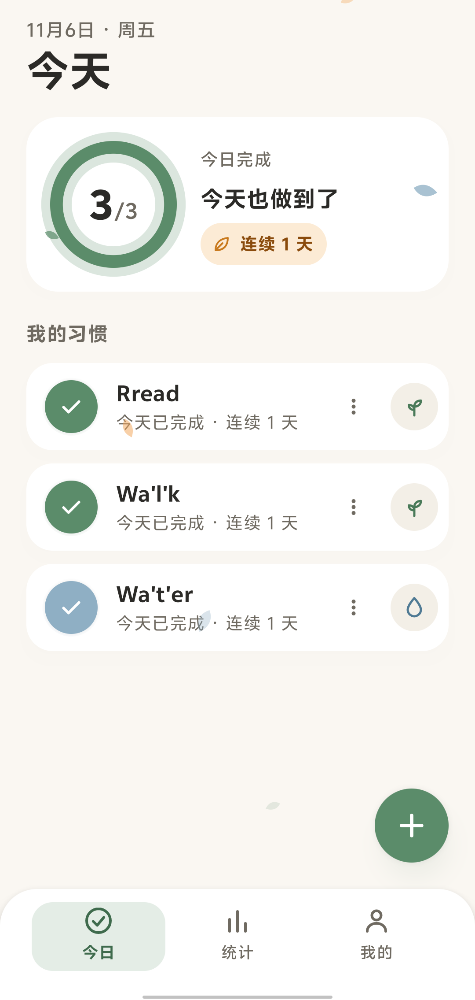
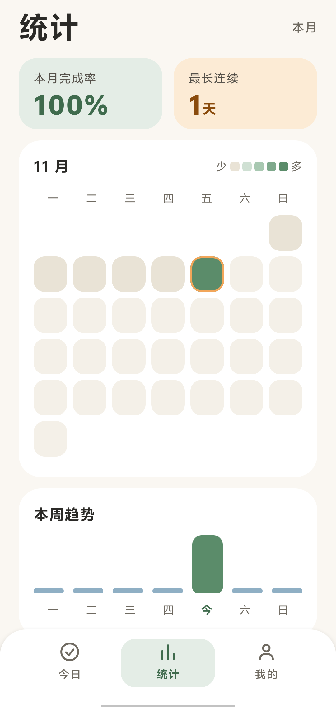
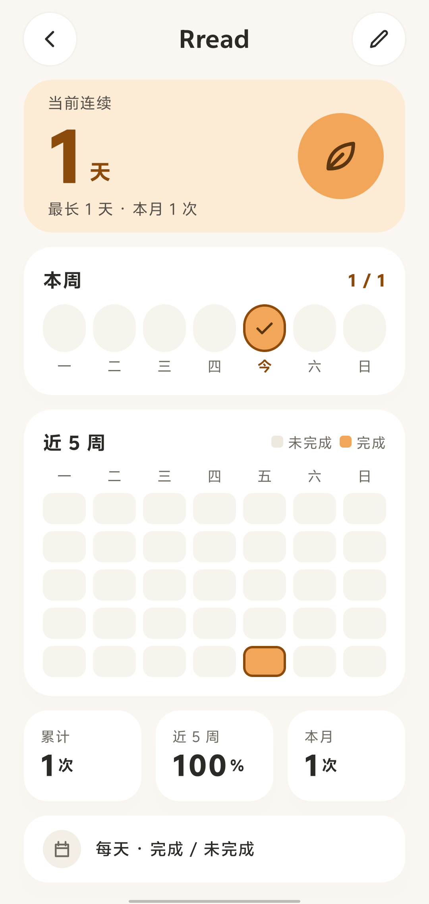
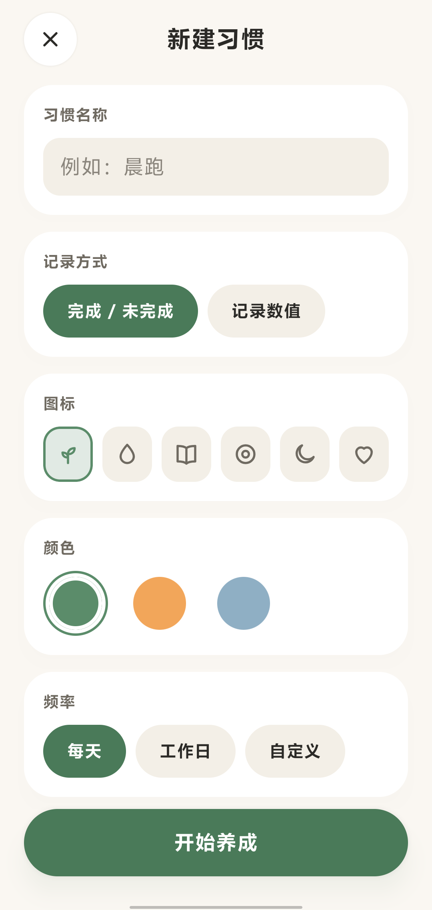

# Habit Tracker

本地优先的 Android 习惯追踪器。Kotlin + Jetpack Compose + Material 3 + Room，单 Gradle module（`:app`），目标 Android 15（API 35），minSdk 26。

<p>
  
  
  
  
</p>

> 仓库已包含可构建的 Android 工程（`:app`）、Room schema v1 与 Domain/Repository 层。所有状态只反映真实执行结果：没有证据的项一律写 `NOT_RUN`/`PARTIAL`。
>
> **发布状态：未发布（WIP）。** 采用 MIT 许可证（`LICENSE`），但尚无远程仓库；多个任务处于 `IMPLEMENTED`（实现+真机自测完成、缺独立评审），按 `ADR-015` 尚未转 `DONE`。

## 1. 当前状态

| 项目 | 状态 |
|---|---|
| 阶段 | `Gate 3` — Today 与新建习惯两页已接线，主路径在真机走通 |
| 当前任务 | `TASK-040`（`IMPLEMENTED`：机型适配——模拟器 5 档手机配置 × 5 页自动断言，修掉大字体裁字与 <48dp 触控；待批量评审） |
| 代码实现 | `DEVICE_VERIFIED`（单模块 `:app`、三页导航、Room schema v1、Repository、UseCase；主路径已真机走通，逐页巡检与 UI 自动化仍缺） |
| 最近构建 | `PASS` — `gradlew assembleDebug`，2026-11-06，13s，APK 10,559,569 B |
| 最近测试 | `PASS` — **159** 项单测（`tools/run-unit-tests.ps1`）+ **6** 项真机 instrumented（`connectedDebugAndroidTest`：5 项 Room 契约 + SmokeTest）；`gradlew test` 仍因沙箱禁用测试 worker 而不可用 |
| 最近数据层校验 | `PASS` — schema 40/40（`verify-schema.mjs`）+ DAO SQL 38/38（`verify-dao.mjs`） |
| ADR | `ADR-001`~`ADR-017` 全部 `ACCEPTED`（`ADR-016` 日切点 04:00、`ADR-017` 设计偏差登记） |
| Git | `main` 为稳定分支；治理任务在 `feat/*` 经独立评审后合入；本地仓库，无远程；基线检查点 `d0f470a` |

## 2. 文档地图

| 文件 | 职责 | 更新频率 | AI 权限 |
|---|---|---|---|
| `AGENTS.md` | AI 必须遵守的开发规则 | 低 | 受保护（需批准 + ADR） |
| `ARCHITECTURE.md` | 系统架构、分层与工程目录 | 低 | 受保护（需批准 + ADR） |
| `DATABASE.md` | 表结构、数据规则、统计口径 | 低 | 受保护（需批准 + ADR） |
| `DEVELOPMENT.md` | 开发规范、阶段计划、验收清单 | 低 | 受保护（需批准 + ADR） |
| `project/REQUIREMENTS.md` | 产品需求与范围 | 中 | 受保护（需批准 + ADR） |
| `project/ROADMAP.md` | 阶段与 Gate | 中 | 可更新（需依据） |
| `project/PROJECT_STATUS.md` | 项目真实状态快照 | 每任务结束 | 可更新（需依据） |
| `project/FEATURE_MATRIX.md` | 功能完成矩阵 | 每次验收 | 可更新（仅限有证据项） |
| `project/tasks/TASK-xxx.md` | 单项任务的范围与验收 | 每任务 | 可更新 |
| `project/handoffs/LAST_HANDOFF.md` | 会话交接 | 每次会话结束 | 可更新 |
| `project/reports/TEST_REPORT.md` | 实际执行的测试记录 | 每次验证 | 可更新（禁止补写未执行项） |
| `project/reports/RELEASE_REPORT.md` | 发布证据与已知限制 | 发布时 | 可更新（需证据） |
| `project/reports/BASELINE_REVIEW.md` | 基线静态审查结论 | 低 | 只读 |
| `project/REVIEW_CHECKLIST.md` | Reviewer 独立评审清单 | 规则变化时 | 可修改 |
| `project/reviews/REVIEW-TASK-xxx.md` | 已完成任务的独立评审结论 | 每次拟合入 `main` 前 | 可新增 |
| `project/decisions/ADR-xxx.md` | 技术决策记录 | 有新决策时 | 只增不改（改状态除外） |
| `tools/check-governance.ps1` | 治理一致性检查脚本（只读） | 规则变化时 | 可修改（不得降低检查强度） |
| `tools/close-task.ps1` | 任务收尾：生成状态摘要并同步 README/状态快照 | 每任务结束 | 可修改 |
| `orgins/**` | 视觉概念稿（HTML 参考） | 只读 | 不得当作生产代码 |

## 3. 工作流

1. 新会话先按 `AGENTS.md` §2 的顺序读取文件，并核对 `git status --short`、当前分支与 `git log -1`。
2. 一次只执行一个 `TASK-xxx`，遵循 `AGENTS.md` §10 的七步生命周期（Bootstrap → Inspect → Plan → Implement → Verify → Persist → Handoff）。
3. 只有存在真实构建/测试证据时，才能把功能标记为 `VERIFIED`；`VERIFIED` ≠ `DEVICE_VERIFIED`。
4. 会话结束必须更新 `PROJECT_STATUS.md`、`TEST_REPORT.md`、`LAST_HANDOFF.md`，并提交一个聚焦 commit。

## 4. 快速命令

```powershell
# 通用做法（任何机器，需 JDK 17 + Android SDK platform 35 / build-tools 35.0.0）
./gradlew assembleDebug
./gradlew testDebugUnitTest      # JVM 单测；正常环境下 Gradle 测试 worker 可用
./gradlew installDebug           # 连接设备并开启 USB 调试

# 作者本机（Windows sandbox：Gradle 测试 worker 被禁，所以另有一个直接跑 JUnit 的入口）
pwsh -NoProfile -File tools/verify-all.ps1       # 收尾统一入口：治理检查 + 单测 + 构建 + 空白检查
gradlew.bat assembleDebug                        # 已验证：SUCCESSFUL
pwsh -NoProfile -File tools/run-unit-tests.ps1   # 已验证：159 项通过（绕过本机被禁的 Gradle 测试 worker）
node tools/verify-schema.mjs                     # 已验证：40/40（schema + 约束）
node tools/verify-dao.mjs                        # 已验证：38/38（DAO 的 SQL 语义，不含 Room 映射）
adb devices                                      # 真机需手动连接（USB 调试已可用）；模拟器不可用：无 WHPX/Hyper-V
pwsh -NoProfile -File tools/close-task.ps1 -Task TASK-xxx -Apply
pwsh -NoProfile -File tools/check-governance.ps1
pwsh -NoProfile -File tools/replay-governance-probes.ps1   # 重放 15 个治理探针（P5–P19）
```

`replay-governance-probes.ps1` 会**临时改写** `TASK-019`、`TEST_REPORT`、manifest 与 build 文件，用 `git show HEAD:` 取原件、`git checkout --` 还原；探测路径上有未提交改动时它直接 `[DIRTY]` 中止，不会覆盖别人的工作。

## 5. 验证

```powershell
pwsh -NoProfile -File tools/check-governance.ps1   # exit 0 = OK, 1 = 有 FAIL
```

脚本只读，检查 22 项（含「`TASK-009` 起必须有 `verify-all` 证据」）：必备文件、状态文件残留 `UNKNOWN`、`TASK/ADR` 引用、功能矩阵状态词表与证据、交接快照是否填写、Markdown 相对链接、冲突标记与行尾空白、本地草稿是否误入库、`.gitignore` 覆盖、发布报告是否与工程状态矛盾、**改受保护基线是否同时带 ADR**（仅空白改动豁免），以及六项状态同步检查：

- `README` 的当前任务/阶段必须与 `PROJECT_STATUS` 一致；
- 每个 ADR 必须在 `PROJECT_STATUS` 中被覆盖，且引用处写的状态词必须与 ADR 文件一致；
- 有 Gradle 工程时 `RELEASE_REPORT` 不得再写“尚无 Android 工程”，`assembleDebug` 也不得仍为 `NOT_RUN`；
- `TEST_REPORT` 的 `Latest Run` 必须与 `Runs` 表最后一行（日期与结果）一致；
- `main` 上的 `PARTIAL` 任务必须在 `PROJECT_STATUS` 的「在册例外」登记；
- `project/REVIEW_CHECKLIST.md` 必须存在且含六个评审小节；`TASK-007` 起的 `DONE` 任务必须有独立 Reviewer 的 `APPROVE` 记录。

它只判断「文档是否自洽」，不判断「代码是否正确」——后者只能靠构建与测试。

## 6. 路线图与下一步

当前在 `Gate 3`，出口 = 设备侧 Room 契约测试（已完成）+ 窄口径里程碑评审。之后：

1. `R1` 窄口径评审：把 8 个 `IMPLEMENTED` 一起过一遍（偏差表 + 写路径/规则边界 + 变异抽查），转 `DONE` 或列阻塞项。
2. `N5` 提醒数据模型 ADR（先于备份格式定稿）。
3. `TASK-030a` JSON 导出（只读）→ `030b` 覆盖恢复（依赖 `TASK-026`）。
4. `TASK-037` 自定义习惯图标：相册自选已实现（`custom:` + `filesDir/icons`）；用户素材包仍待提供文件。
5. UI 自动化 ≤8 用例、迁移测试底座、`assembleRelease` + lint 进 CI。

细节见 `project/ROADMAP.md`、`project/PROJECT_STATUS.md` 与 `project/handoffs/LAST_HANDOFF.md`。

## 7. 隐私与 AI 说明

- **数据存哪**：只在本机 Room 数据库（`habit-tracker.db`），无账号、无服务器、无云同步。
- **网络**：`AndroidManifest.xml` 没有 `INTERNET` 权限，依赖列表里没有网络库。
- **权限**：`POST_NOTIFICATIONS`（提醒，尚未上线）与 `RECEIVE_BOOT_COMPLETED`（重启后恢复提醒，尚未上线）；不申请存储权限，导入导出走系统文件选择器。
- **卸载即丢失**：`allowBackup="false"`；备份导出（`TASK-030`）完成前，卸载或清除数据会丢失全部记录。
- **AI 辅助**：本项目在 AI 编码代理协助下开发，治理文档（`AGENTS.md`、任务记录、评审记录、测试报告）按「只写实际执行结果」的规则维护。
- **图标**：`docs/images/icon.png` 与 `res/mipmap-*/ic_launcher.png` 由仓库所有者提供，随本项目一并使用。

## 8. 开源/发布前检查

- 许可证：**MIT**（`LICENSE`）。若仓库所有者要改为 Apache-2.0 或专有许可，替换 `LICENSE` 并同步本节与 `README` 第 1 节的发布状态即可。
- 远程：当前无 `origin`，首次推送由所有者执行；本仓库不自动推送。
- CI：`.github/workflows/android.yml` 在 Ubuntu 上跑 `assembleDebug` + 单测 + schema/DAO 校验（本机受限的 Gradle 测试 worker 在 GitHub Runner 上不受限）。
- 敏感信息：`.gitignore` 覆盖 `local.properties`、`*.jks`、`*.keystore`、`*.apk`、`.gradle/`；仓库内无真实用户数据（真机数据库仅存在设备与本地 `.gradle/`）。
- 设备序列号与个人绝对路径：文档中已脱敏为 `<device>`；工具链路径改为环境变量优先。
